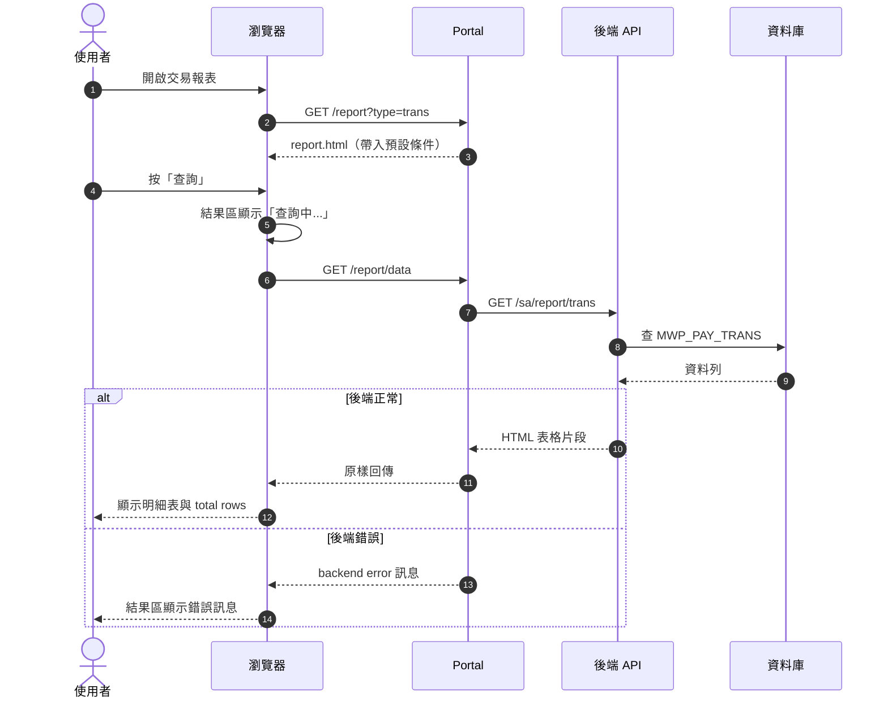
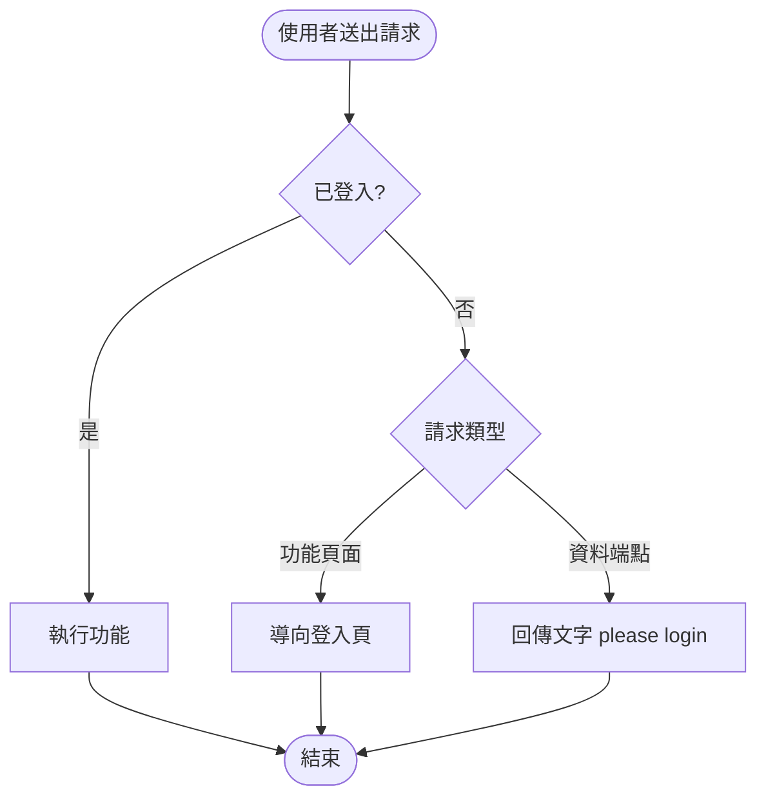
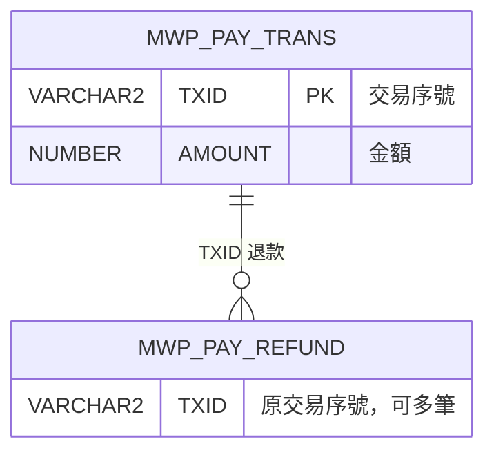

# gen-user-story：從 SRS 產出 User Story、需求追溯矩陣與系統設計文件

## 目標

把 `docs/new-pay_Portal_SRS.docx`（唯一的需求來源；舊的 `new-pay_OnlineStore_FSD.md` 已降級為背景資料，**不要讀**）轉成兩本文件：

| 產出 | 讀者 | 內容 |
|---|---|---|
| `docs/new-pay_Portal_SRS.md` | 後續所有 skill | SRS 的 Markdown 版（轉檔產物，入版控；之後不再碰 docx） |
| `docs/user-stories.md` ＋ `.docx` | 業務、主管、客戶 | User Story、驗收條件、實作狀態、需求追溯矩陣——**用使用者看得懂的話** |
| `docs/SD.md` ＋ `.docx` | 工程師、測試 | 系統設計：Sequence Diagram、Activity Diagram、ER Model——**技術細節都放這裡** |

兩本的分工是本 skill 的核心：**User Story 講「使用者在畫面上做什麼、看到什麼」；SD 講「系統怎麼做到」**。URL、HTTP 狀態碼、參數、session、資料表欄位一律寫進 SD，不要出現在 AC 裡。

這是 workshop SDLC 流程的第一站。評量標準：
1. **追溯完整**：SRS 的每一條需求條文（`P-<模組>-<nn>`）都被某個 US 的 AC 涵蓋，或明列在「不納入」清單。
2. **圖可渲染**：SD.md 的每張 Mermaid 圖都能被 `mermaid-cli` 轉成圖檔，零語法錯誤。

## 讀哪些東西（依序）

| 來源 | 看什麼 | 用在 |
|---|---|---|
| SRS 1.5、2.3、2.4、2.5 | 編號規則、使用者角色與業務分工、功能總覽、整體操作流程 | US 角色、SD 架構圖 |
| SRS 第 3 章（P-COM-*） | 共用需求：存取控制、導覽、介接、結果呈現、輸入、格式 | US-COM、AD |
| SRS 第 4 章 | 各頁面的畫面元素、操作流程、狀態與流程、需求條文、後端介面 | US、SD |
| SRS 第 5 章 | Portal 端點總表、後端 API 總表 | SD（訊息名稱） |
| SRS 第 6 章 | 資料表、代碼表、初始資料 | ER Model |
| SRS 第 7、8 章 | 非功能需求、範圍外事項 | 「不納入」清單 |
| `portal/src/main/resources/templates/*.html`、`PortalController.java` | 條文描述的行為程式裡有沒有、是否相符 | 實作狀態欄、SD 校正 |
| `docs/user-stories.md`（若已存在） | 增量更新，沿用既有 US 編號，不要重編 | |

## 流程

### 1. 轉檔（docx → md）

```bash
npx -y mammoth docs/new-pay_Portal_SRS.docx --output-format=markdown > docs/new-pay_Portal_SRS.md
```

- 用 mammoth 而不是 pandoc：學員機器一定有 Node（portal-e2e 的前提），不必額外安裝。
- mammoth 會把標點跳脫成 `4\.1`、`P\-LGN\-01` 這種形式，讀起來無礙，不必清理。

### 2. 盤點條文

```bash
# 全部條文（去跳脫、去重）
grep -oE 'P\\?-[A-Z]+\\?-[0-9]+' docs/new-pay_Portal_SRS.md | tr -d '\\' | sort -u
# 各模組條文數
grep -oE 'P\\?-[A-Z]+\\?-[0-9]+' docs/new-pay_Portal_SRS.md | tr -d '\\' | sed -E 's/P-([A-Z]+)-.*/\1/' | sort | uniq -c
```

這份清單就是追溯矩陣的母體。先告訴使用者總共幾條、分布在哪些模組，再往下做。

### 3. 產 User Story（`docs/user-stories.md`）

#### 3.1 切分

分模組寫（COM／LGN／HOME／RPT／RFD／RCN／TOS／BNK／CSR），每個模組一節：

- 一個 US = 一個使用者能獨立完成、獨立驗收的目標（「查詢交易報表」是一個 US；「小時下拉有 24 個選項」不是 US，是某個 US 的 AC）。
- **每個模組 2〜5 個 US**（HOME 這種單純頁面可以 1〜2 個）。查詢類頁面通常拆成「開啟頁面與輸入條件」「查詢並閱讀結果」「查無資料與異常」；維護類（TOS／BNK）再加「新增／存檔」。把一整個模組塞成一個 US、底下掛 7 條 AC 是錯的。

#### 3.2 用使用者的語言寫

US 文件的讀者是業務與客戶。寫之前先問：**「使用者坐在畫面前，會怎麼描述這件事？」**

**角色**：用 SRS 2.3 的業務身分，不用帳號名稱。

| 不要寫 | 要寫 |
|---|---|
| sa 帳號 | 營運人員（BO）／產品經理（PM）／財務人員 |
| cp 帳號 | 商家 |
| csr 帳號 | 客服人員 |
| 任何已登入使用者 | Portal 使用者 |

**故事句**：`身為 <業務角色>，我想要 <業務目標>，以便 <業務價值>`。目標與價值都要是業務語言——「以便月底跟商家核對款項」，不是「以便呼叫 /recon/data 取得資料」。

**驗收條件**：描述畫面上看得到的操作與結果。下表左欄的東西不准出現在 AC：

| 技術寫法（移到 SD） | 使用者寫法（留在 AC） |
|---|---|
| 未登入 GET /report 回 302 導向 /login | 沒登入就打開交易報表，會被帶回登入頁 |
| 呼叫 $.get /report/data?type=trans&from=… | 按下「查詢」後，結果區先顯示「查詢中...」，接著出現交易明細表 |
| session.invalidate()、JSESSIONID | 按「登出」後回到登入頁，之後要重新登入才能使用功能 |
| HTTP 400／405 | （使用者看不到狀態碼——改寫成畫面現象，或整條歸到 SD） |
| MWP_PAY_TRANS.TX_DT 欄位 | 交易時間 |
| `#queryBtn`、`$('#result').html()` | 「查詢」按鈕、結果區 |
| from 補 0000、to 補 5959 | 查 9/16 00 時到 23 時，會包含 23:59:59 那一筆 |

可以保留的：畫面上真的會出現的文字（按鈕名、提示訊息、`total rows: N`、`backend error: ...`）——用「」括起來照抄；使用者要輸入的格式用例子說明（「日期輸入 8 碼，例如 20260916」）。

**一條條文若純粹是技術規格**（例如「Portal 以 application/x-www-form-urlencoded 送出」、「缺參數回 HTTP 400」），使用者無從觀察——不要硬寫成 AC，改在 AC 寫「系統行為依 SD-xx 所述」並在矩陣備註「技術規格，見 SD」，或直接列入「不納入」清單說明原因。兩種做法都要讓條文編號出現在文件裡。

**現況像 bug 的行為**照寫，句尾加 `（現況如此）`——例如「起日晚於迄日仍可查詢，系統不提示（現況如此）」。這些之後會變成 `@legacy` 情境，不要「順手修正」成理想行為，**更不要發明 SRS 沒寫的提示訊息**。

#### 3.3 格式

```markdown
### US-RPT-02 查詢並閱讀交易明細
**身為** 營運人員或商家，**我想要** 依日期、時段與商家查出交易明細，**以便** 掌握每天的收款狀況。

| | |
|---|---|
| SRS 章節 | 4.3 |
| 涵蓋條文 | P-RPT-04, P-RPT-05, P-RPT-07 |
| 對應設計 | SD-03、AD-02 |
| 實作狀態 | 已實作 |
| 優先級 | 高 |

**驗收條件**
- AC1（P-RPT-04）：按下「查詢」後，結果區先顯示「查詢中...」，接著換成交易明細表。
- AC2（P-RPT-07）：明細表最多列出 10 筆，表格下方顯示「total rows: N」，N 是符合條件的全部筆數。
- AC3（P-RPT-05）：查 9/16 的 00 時到 23 時，結果包含當天 23:59:59 的交易。
```

- **每條 AC 都要括號標注它涵蓋的條文編號**——這是追溯矩陣的資料來源，不能省。
- 「涵蓋條文」列逐條列出，不用範圍寫法。
- 「對應設計」指向 SD.md 的圖編號，讓工程師從需求跳到設計。

### 4. 標實作狀態

對照 template 與 controller 快掃一輪，每個 US 填一個狀態：

- **已實作**：條文描述的行為在程式裡都找得到。
- **未實作**：SRS 有寫、程式沒做。照樣要列，後面的測試階段會列入「不測」清單。
- **現況與條文不符**：程式行為跟條文對不上。把差異寫成一行備註。這是學員最該停下來看的訊號。

### 5. 追溯矩陣與完整性自檢

`user-stories.md` 文末附兩張表：

```markdown
## 需求追溯矩陣
| 條文 | US | AC | 備註 |
|---|---|---|---|
| P-LGN-01 | US-LGN-01 | AC1 | |
| P-COM-18 | US-COM-04 | —— | 技術規格，見 SD-03 |

## 不納入 User Story 的條文
| 條文 | 原因 |
|---|---|
| P-API-01 | 後端介面規格，見 SD |
| P-NFR-01 | 非功能需求（建置），不以 US 承載 |
```

自檢（三項都要過）：

```bash
# (a) 每條條文都出現在文件裡
grep -oE 'P\\?-[A-Z]+\\?-[0-9]+' docs/new-pay_Portal_SRS.md | tr -d '\\' | sort -u | \
  while read id; do grep -q "$id" docs/user-stories.md || echo "缺: $id"; done
# (b) 各模組 US 數（每模組應 2〜5 個，HOME 可 1〜2）
grep -oE '^### US-[A-Z]+' docs/user-stories.md | sort | uniq -c
# (c) AC 裡不該出現的技術字眼（有輸出就逐條改寫）
grep -E '^- AC' docs/user-stories.md | grep -E '/[a-z]{3,}|HTTP|30[0-9]|40[0-9]|session|\$\.|\#[a-zA-Z]|MWP_|[A-Z]{2,}_[A-Z]{2,}|yyyy|GET |POST '
```

注意：「不納入」表也要**逐條**列出編號（`P-NFR-01～11` 會讓 (a) 誤報缺漏）。

### 6. 產出系統設計文件（`docs/SD.md`）

所有圖一律用 **Mermaid**（GitHub、VS Code 直接預覽；只需 Node，不必裝 Java）。不要用 ASCII 圖、不要另外產 `.puml` 檔——全部內嵌在 SD.md 一份文件。

#### 6.1 文件結構

```
# new-pay Portal 系統設計文件（SD）
## 1. 系統架構           ← 一張 flowchart：瀏覽器 → Portal(8098) → 後端(8099) → DB
## 2. 循序圖 Sequence Diagram
### SD-01 登入與登出
### SD-02 首頁
### SD-03 交易報表查詢
### SD-04 退款報表查詢
### SD-05 對帳查詢（每日／每月／差異明細）
### SD-06 服務條款設定
### SD-07 商家銀行帳戶註冊
### SD-08 CSR 交易查詢
## 3. 活動圖 Activity Diagram
### AD-01 存取控制（每個請求進來的判斷）
### AD-02 報表查詢與結果呈現
### AD-03 Portal 轉呼叫後端與錯誤處理
### AD-04 服務條款狀態流程
### AD-05 銀行帳戶新增與存檔
## 4. 資料模型 ER Model
## 附錄 A 設計元素 ↔ SRS 條文 ↔ User Story 對照表
```

每張圖下方用 2〜5 行文字說明「這張圖要看什麼」與對應條文，不要只丟圖。

#### 6.2 Sequence Diagram：每個頁面一張

參與者固定這五個（頁面用不到的可省略）：



- 訊息上的端點、參數以 SRS 第 5 章與 `PortalController` 為準，兩者不一致時以程式為準並在說明文字註明差異。
- 分支用 `alt/else`、可選步驟用 `opt`、補充用 `Note over`。

#### 6.3 Activity Diagram：用 flowchart 畫

Mermaid 沒有專用的活動圖語法，用 `flowchart TD` 表達：圓角 `([開始])`／`([結束])` 為起訖、`{判斷?}` 為決策、`[動作]` 為活動。



**每個判斷節點都必須對應到 SRS 條文**；條文沒寫的分支（例如前端驗證、確認對話框）不要自己發明——SRS 寫「沒有」就畫「沒有」，並標（現況如此）。

#### 6.4 ER Model：只畫 SRS 6.1 的資料表



- 實體 = SRS 6.1 列出的資料表，表名照抄；**不要發明** User、Merchant、Session 之類 SRS 沒有的實體。
- 欄位照 6.1 的欄位表；型別只寫型別名（`VARCHAR2`），長度寫進說明字串（Mermaid 型別不能有括號）。
- 關聯只畫 SRS 有依據的（例如 REFUND.TXID 指向原交易）。SRS 若註明「無 PK」「無 FK 約束」，在圖下文字說明這是**邏輯關聯**。
- 圖下附「資料表 ↔ 使用頁面」對照表。

#### 6.5 Mermaid 語法地雷（轉圖失敗多半是這幾個）

| 地雷 | 寫法 |
|---|---|
| flowchart 節點文字含 `( ) [ ] { } / : ;` 或 `"` | 整段用雙引號包：`A["回傳 FAIL: 原因"]` |
| sequence 訊息含 `;` 或 `#` | 拿掉或改全形；`#` 會被當成 HTML entity |
| erDiagram 型別含括號 `VARCHAR2(15)` | 只寫 `VARCHAR2`，長度放說明字串 |
| erDiagram 屬性說明 | 必須用雙引號 |
| 節點 id 用中文 | id 用英數（`C1`），中文放在顯示文字 |
| `end` 當節點文字 | flowchart 中小寫 `end` 是保留字，改 `E([結束])` |

### 7. 轉圖檢查與產出 Word 交付檔

```bash
mkdir -p docs/.build
# (1) Mermaid 轉 PNG＋產生引用圖片的 md；任何一張圖語法錯誤會在這步失敗
npx -y @mermaid-js/mermaid-cli@11 -i docs/SD.md -o docs/.build/SD.md -e png -s 2
# (2) 兩本文件轉 Word。SD 必須「進到 .build 目錄」再轉：markdown-docx 以目前目錄解析 ./SD-1.png，
#     在專案根目錄執行會找不到圖，但它照樣印 created successfully（圖全掉、不報錯）
(cd docs/.build && npx -y markdown-docx -i SD.md -o ../SD.docx \
  -t '{"imageDefaultSize":"auto","imageHorizontalAlign":"center"}')
npx -y markdown-docx -i docs/user-stories.md -o docs/user-stories.docx
# (3) 驗證：兩個數字必須相等
echo "mermaid 區塊 $(grep -c '^```mermaid' docs/SD.md)／docx 圖片 $(unzip -l docs/SD.docx | grep -c 'word/media/.*png')"
```

- 第 (1) 步是 SD 的**語法驗收**：輸出每張圖都要 ✅，有 ✗ 就回 SD.md 修，修到全過才往下。
- `imageDefaultSize: auto` 把圖等比縮進 A4 邊界（不加會以原始像素嵌入，寬達 40 cm、溢出頁面）。單張圖若太寬或太高、縮完字太小，就回 SD.md 拆成兩張。
- `docs/.build/` 是中間產物，不入版控（已列在 `.gitignore`）。
- docx 是 md 的轉出產物：**內容永遠改 md、改完重轉**，不要直接編輯 docx。
- mermaid-cli 第一次執行會下載 headless Chromium，約需一分鐘。

### 8. 回報

- US 總數（分模組）、涵蓋條文數／條文總數（要 100%，含不納入）
- 實作狀態統計：已實作幾個、未實作幾個、不符幾個（不符的逐條列差異）
- SD：SD／AD 各幾張、ER 幾個實體、轉圖是否全數成功
- 「SRS 可能缺漏」清單：程式有、SRS 沒寫的行為
- 建議下一步：執行 `/gen-gherkin`

## 不要做

- 不要讀 `new-pay_OnlineStore_FSD.md`（已被 SRS 取代；兩者矛盾時一律以 SRS 為準）。
- 不要改 `portal/`、`backend/`、`portal-e2e/`——這一站只產需求與設計文件。
- 不要因為程式沒實作就略過條文；也不要替 SRS「補需求」——不發明條文編號、不發明提示訊息、不發明資料實體。
- 不要把 URL、狀態碼、參數、selector、資料表欄位寫進 AC——那些屬於 SD 與 gen-gherkin。
- 不要產 `.puml` 或 ASCII 圖；SD 的圖只用 Mermaid，且必須通過第 7 步轉圖。
- 不要在文件標頭寫自己沒驗證過的統計數字；數字一律由第 5 步的指令算出來再填。
