# new-pay Portal 系統設計文件（SD）

> 需求來源：`docs/new-pay_Portal_SRS.md`（SRS 1.0）；User Story：`docs/user-stories.md`。
> 端點與參數以 SRS 第 5 章與 `portal/.../PortalController.java` 為準；兩者若有不一致，以程式為準並在圖下說明。本版次對照結果：Portal 端點、參數、未登入回應與 SRS 5.1 完全一致。

## 1. 系統架構

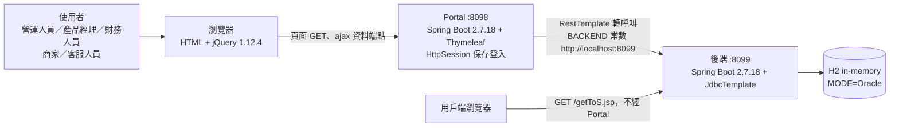

- Portal 不存取資料庫（P-COM-13）；每個資料端點對應一個後端 API，回應字串原樣轉回瀏覽器。
- 後端位址寫死在 `PortalController.BACKEND`（P-COM-14）；`application.properties` 的 `newpay.backend.url` 保留未用（SRS 7.5）。
- Portal 啟動不依賴後端；後端未啟動時頁面可開、可登入，查詢回 `backend error:`（P-NFR-03）。
- 後端 API 不要求認證；Portal 的登入檢查只在 Portal 這一層（SRS 7.3）。

## 2. 循序圖 Sequence Diagram

### SD-01 登入與登出

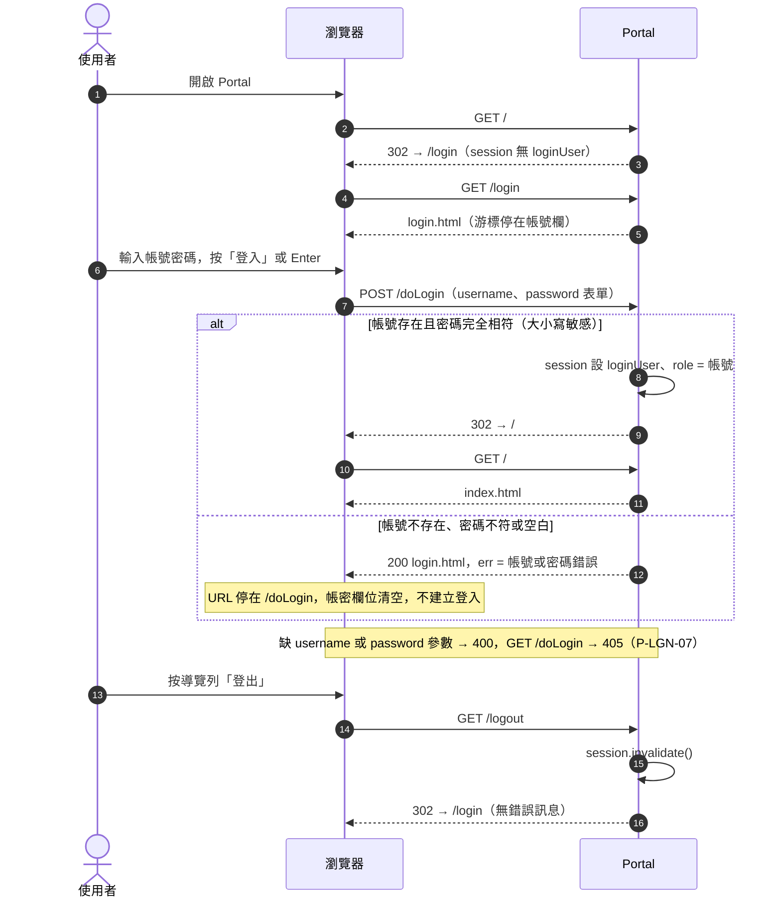

- 帳號表為程式常數 `USERS`（sa/sa、cp/cp、csr/csr），密碼明碼比對（P-LGN-01）。
- 再次登入不換 session id，只覆寫 `loginUser`、`role`（P-LGN-06）；無失敗次數限制與驗證碼（P-LGN-08）。
- session 逾時為 Servlet 容器預設 30 分鐘，以 cookie `JSESSIONID` 識別（P-COM-06）。

### SD-02 首頁

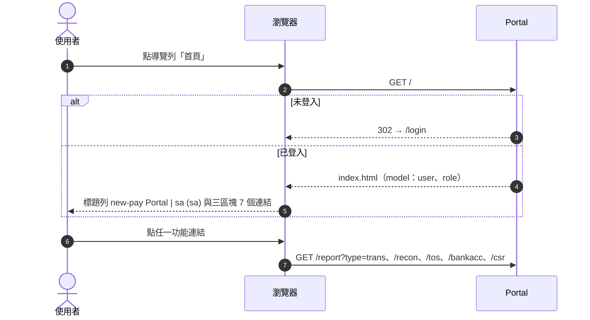

- 首頁是唯一在標題列顯示 `(role)` 的頁面（P-COM-07、P-HOME-03）；三個帳號看到的內容相同（P-HOME-02）。
- 選單不依角色過濾（P-COM-09）；Merchant 區塊沒有退款報表連結（P-HOME-04）。
- 各頁只載入 `/css/portal.css` 與 `/js/jquery.min.js`，不用外部 CDN（P-COM-12）。

### SD-03 交易報表查詢

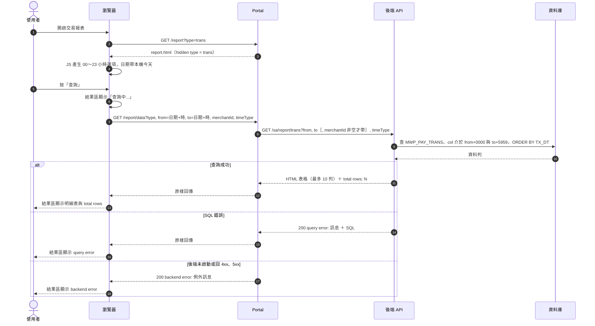

- `col` = `AUTH_DT`（timeType=auth）或 `TX_DT`（其他）；排序固定 `TX_DT`（P-RPT-04、P-RPT-07）。
- `type` 只判斷是否等於 `refund`，其他值一律走交易報表（P-RPT-12）；參數直接串入 URL、不做 URL 編碼（P-COM-18）。
- 缺 `type`、`from`、`to` → Portal 回 400，不轉呼叫（P-COM-19）。

結果欄位（P-RPT-06）——User Story 用中文名稱，畫面表頭顯示代號：

| 畫面表頭 | 中文名稱 | | 畫面表頭 | 中文名稱 |
|---|---|---|---|---|
| TXID | 交易序號 | | TX_DT | 交易時間 |
| MERCHANT_ID | 商家 | | AUTH_DT | 授權時間 |
| ACC_ID | 門號 | | BILL_CSPTIME | 請款時間 |
| AMOUNT | 金額 | | MEMO | OLS 單號（CorrelationId） |
| CURRENCY | 幣別 | | MERCHANDIZE_NAME | 商品名稱 |
| TX_STATUS | 交易狀態 | | REFERENCE | 商家聯絡資訊（MerchantContact） |

### SD-04 退款報表查詢

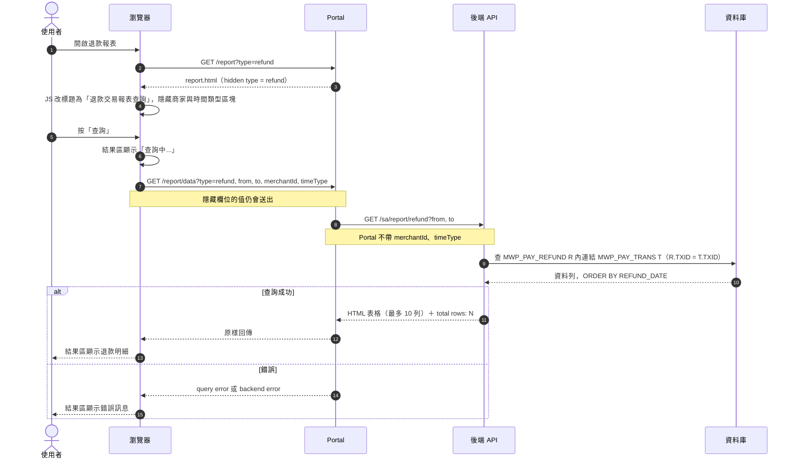

- 區間欄位為 `REFUND_DATE`（P-RFD-02）；內連結使找不到原交易的退款不出現（P-RFD-05）。
- 結果欄位（P-RFD-03）：TXID 交易序號、AMOUNT 退款金額、REFUND_STATUS 退款狀態、REFUND_DATE 退款時間、MEMO 原交易 OLS 單號、AUTH_DT 原交易授權時間。

### SD-05 對帳查詢（每日／每月／差異明細）

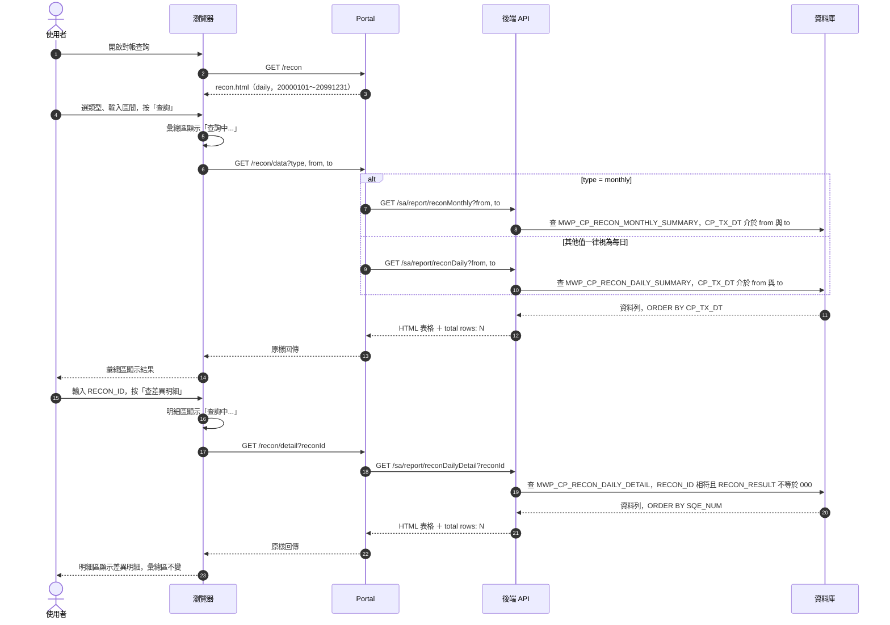

- 彙總區（`#result`）與明細區（`#detail`）各自更新、互不清除（P-RCN-10、P-RCN-12）。
- 明細只查每日明細表；`M` 開頭的 RECON_ID 必為 0 筆（P-RCN-08）；空 reconId 照送（P-RCN-09）。
- 差異明細 20 欄（P-RCN-07）：RECON_ID、RECON_SEQ_NUM、MERCHANT_ID、BILLING_AGREEMENT_ID、CORRELATION_ID、SQE_NUM、TXID、STATUS、ITEM_PRICE、TAX、TOTAL_AMOUNT、ROUND_AMOUNT、CURRENCY、LAST_EVENT、TIMESTAMP、EVENT_RESPONSE、EVENT_RESPONSE_DESCRIPTION、CREATE_TIME、RECON_RESULT、RECON_MESSAGE。
- 每日彙總 8 欄、每月彙總 7 欄，見第 4 章 ER Model（P-RCN-02、P-RCN-03）。

### SD-06 服務條款設定

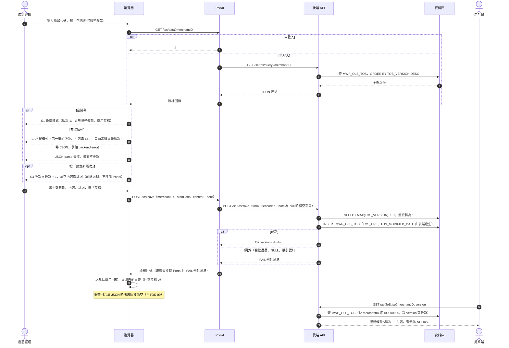

- 後端 `/sa/tos/query` 沒有 try/catch：merchantID 含單引號時回 HTTP 500，Portal 轉成 `backend error:`，頁面因非 JSON 不更新——與 P-COM-31「查詢回 query error」不符（見 US-COM-05）。
- 後端未啟動時存檔回 `FAIL …`，重查回 `backend error:`，頁面不更新，因此 `FAIL` 訊息不會被清空——與 P-TOS-14 前半句不符（見 US-TOS-04）。
- JSON 鍵為欄位名，`TOS_VERSION` 為數字、`TOS_CONTENT`（CLOB）轉字串（P-API-04）。

### SD-07 商家銀行帳戶註冊

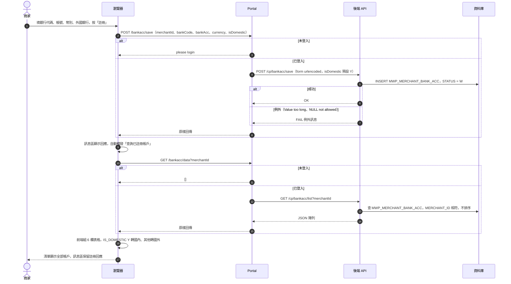

- 清單不限 10 筆、沒有 total rows、表格沒有 `border=1`（P-BNK-05、P-BNK-06）。
- 清單回應非 JSON 時 `JSON.parse` 失敗，清單不更新（P-BNK-11）。
- `/cp/bankacc/list` 同樣沒有 try/catch，merchantId 含單引號回 500 → `backend error:`（同 SD-06 的差異）。

### SD-08 CSR 交易查詢

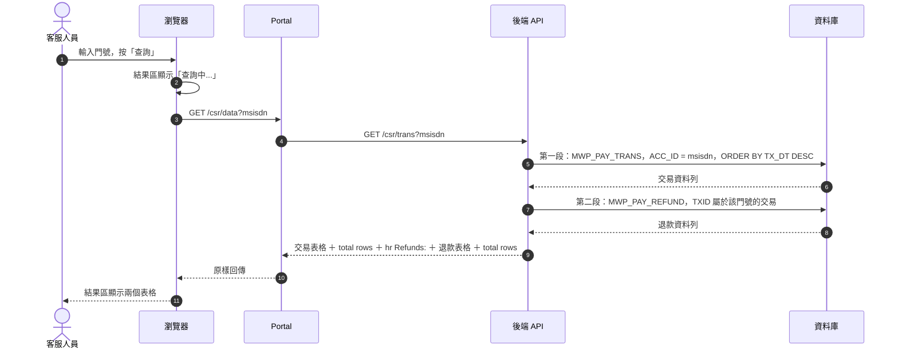

- 兩段 SQL 各自 try/catch，可能只有一段出現 `query error:`（P-CSR-10）。
- 交易表 8 欄（P-CSR-03）：TXID、AMOUNT、TX_STATUS、TX_DT、AUTH_DT、MERCHANDIZE_NAME、REFERENCE、RETURN_CODE；退款表為 MWP_PAY_REFUND 全部 8 欄（P-CSR-05）。

## 3. 活動圖 Activity Diagram

### AD-01 存取控制

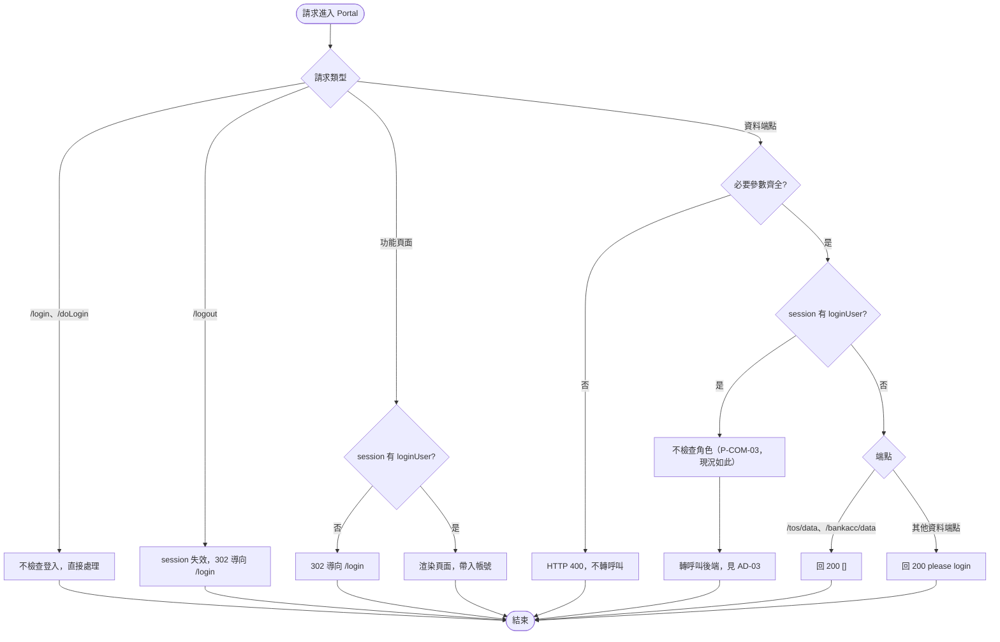

- 判斷依據：功能頁面 P-COM-01；資料端點未登入回應 P-COM-02；不檢查角色 P-COM-03；登出 P-COM-05；缺參數 P-COM-19。
- 參數綁定先於登入檢查：未登入且缺參數時回 400 而非 please login（程式行為，SRS 未明寫順序）。

### AD-02 報表查詢與結果呈現

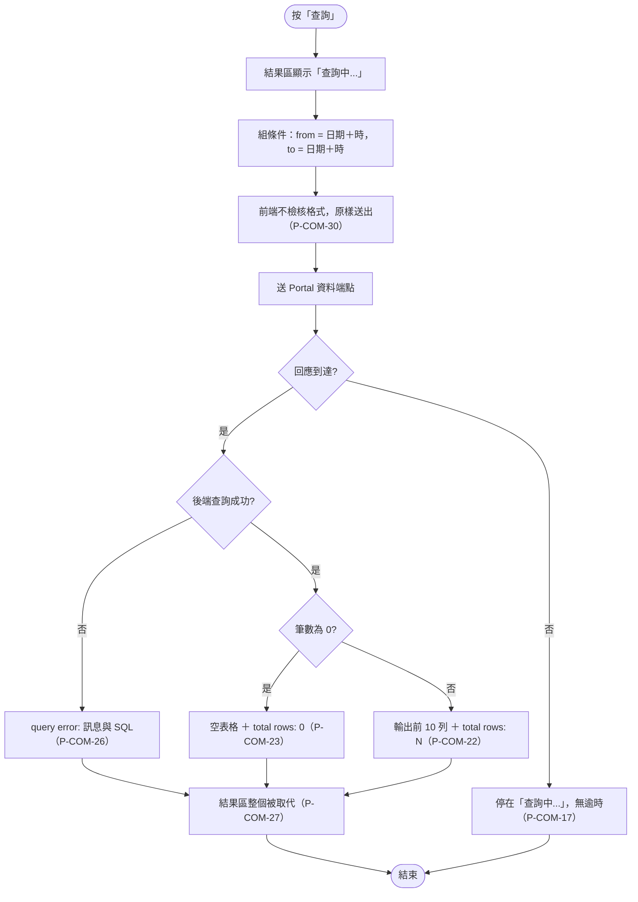

- 時間區間：後端將 from 補 `0000`、to 補 `5959`，以字串比較，兩端包含（P-COM-35、P-RPT-03）。
- 查詢按鈕不停用；連按多次以最後到達的回應為準（P-COM-28）。
- 欄位值原樣輸出、不轉義；NULL 輸出 `null`（P-COM-24、P-COM-25）。

### AD-03 Portal 轉呼叫後端與錯誤處理

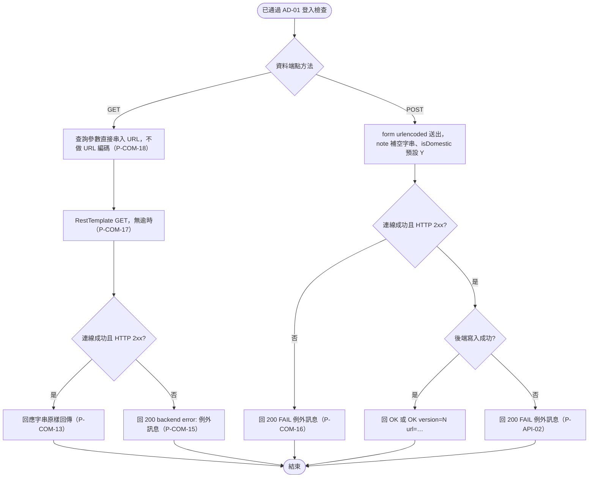

- 後端業務錯誤一律 HTTP 200（`query error:`／`FAIL`）；404／400／405 由 Portal 轉成 `backend error:`（P-API-02）。
- 回應 Content-Type：HTML 表格類 `text/html;charset=UTF-8`、JSON 類 `application/json`、OK／FAIL 依 Spring 預設，Portal 一律當字串轉送（P-API-01）。

### AD-04 服務條款狀態流程

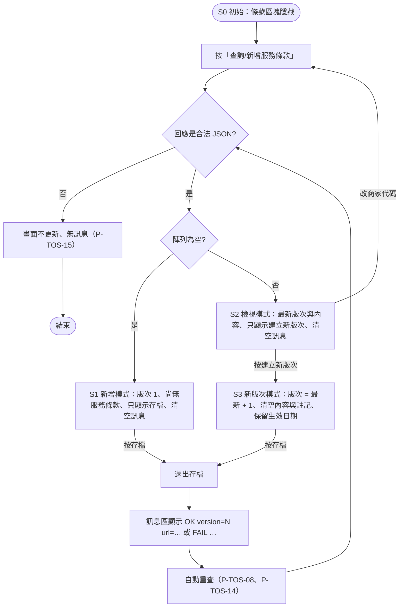

- 狀態定義依 SRS 4.6.2；畫面沒有存檔前的確認對話框，也沒有前端格式檢核（P-TOS-12）。
- S3 的「最新 + 1」只是預覽，實際版次由後端 `MAX(TOS_VERSION)+1` 決定（P-TOS-07、P-TOS-11）。
- 舊版次沒有修改入口（P-TOS-10）。

### AD-05 銀行帳戶新增與存檔

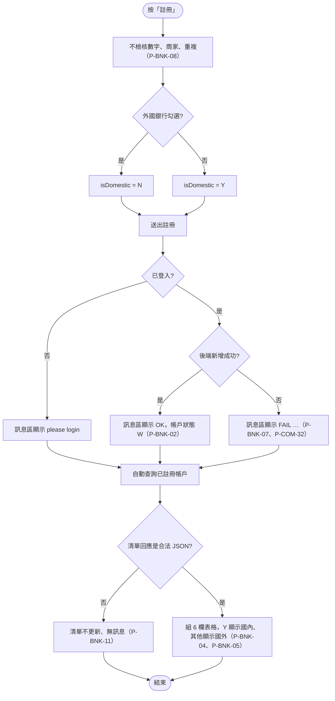

- 清單查詢不會清除訊息區（P-BNK-10）；未登入時清單回 `[]`，顯示只有表頭的表格。
- 本版次無審核流程，狀態停在 W（P-BNK-13）。

## 4. 資料模型 ER Model

只畫 SRS 6.1 列出的 7 張資料表。為避免單張圖過寬，分成交易、對帳、設定三張。

### ER-1 交易與退款

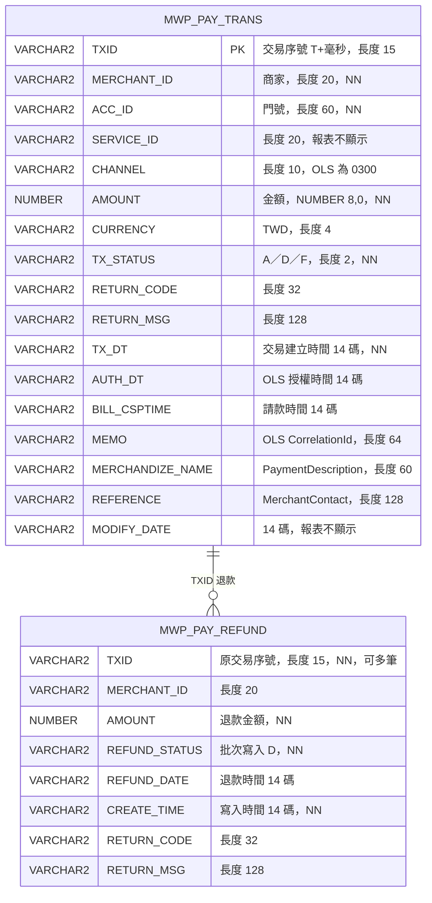

- `MWP_PAY_REFUND` 無 PK、無 FK 約束；與交易主檔以 `TXID` 為**邏輯關聯**，一筆交易可有多筆退款。退款報表以內連結取原交易的 MEMO、AUTH_DT（P-RFD-03、P-RFD-05）。

### ER-2 對帳

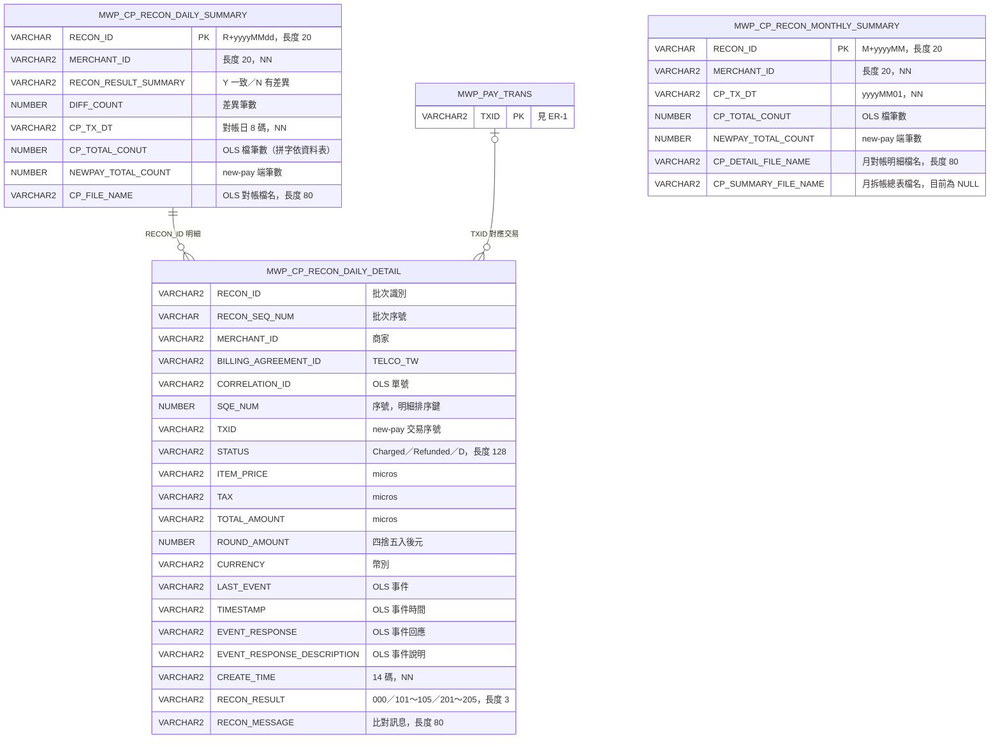

- 彙總與明細以 `RECON_ID` 為**邏輯關聯**（差異明細查詢以 RECON_ID 篩選，P-RCN-06）；明細的 `TXID` 對應交易主檔，但 101／102 類差異代表一端沒有資料，因此為「零或一」。兩者皆無 FK 約束。
- `MWP_CP_RECON_MONTHLY_SUMMARY` 與其他表在 SRS 中沒有關聯依據，獨立呈現。
- SRS 6.1 未列明細表除 STATUS、CREATE_TIME、RECON_RESULT、RECON_MESSAGE 以外的型別，圖中型別取自 `backend/src/main/resources/schema.sql`（列入「SRS 可能缺漏」）。

### ER-3 設定

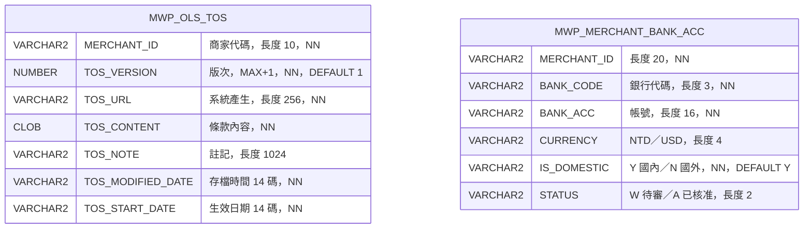

- 兩表皆無 PK、無唯一鍵；同商家同版次條款、相同銀行帳戶可重複寫入（SRS 7.3）。SRS 沒有商家主檔，`MERCHANT_ID` 不畫關聯。
- 初始資料：`MWP_OLS_TOS` 有 I00000000 v1、E000001 v1；`MWP_MERCHANT_BANK_ACC` 有 E000001／007／1234567890123456／USD／N／A（P-TOS-18、P-BNK-12）。

### 資料表 ↔ 使用頁面

| 資料表 | 使用頁面 | 後端 API | 存取 |
|---|---|---|---|
| MWP_PAY_TRANS | 交易報表、退款報表、CSR 查詢 | /sa/report/trans、/sa/report/refund、/csr/trans | 讀 |
| MWP_PAY_REFUND | 退款報表、CSR 查詢 | /sa/report/refund、/csr/trans | 讀 |
| MWP_CP_RECON_DAILY_SUMMARY | 對帳查詢（每日） | /sa/report/reconDaily | 讀 |
| MWP_CP_RECON_MONTHLY_SUMMARY | 對帳查詢（每月） | /sa/report/reconMonthly | 讀 |
| MWP_CP_RECON_DAILY_DETAIL | 對帳查詢（差異明細） | /sa/report/reconDailyDetail | 讀 |
| MWP_OLS_TOS | 服務條款設定、用戶端條款頁 | /sa/tos/query、/sa/tos/save、/getToS.jsp | 讀、新增 |
| MWP_MERCHANT_BANK_ACC | 商家銀行帳戶註冊 | /cp/bankacc/list、/cp/bankacc/save | 讀、新增 |

## 附錄 A 設計元素 ↔ SRS 條文 ↔ User Story 對照表

| 設計元素 | SRS 條文 | User Story |
|---|---|---|
| 1 系統架構 | P-COM-13, P-COM-14, P-NFR-03, P-NFR-04, P-NFR-05, P-NFR-10 | US-COM-04 |
| SD-01 登入與登出 | P-LGN-01～P-LGN-09, P-COM-04, P-COM-05, P-COM-06 | US-LGN-01, US-LGN-02, US-LGN-03, US-COM-01 |
| SD-02 首頁 | P-HOME-01～P-HOME-05, P-COM-07～P-COM-12 | US-HOME-01, US-HOME-02, US-COM-02 |
| SD-03 交易報表查詢 | P-RPT-01～P-RPT-13, P-COM-15, P-COM-18, P-COM-19, P-COM-20～P-COM-26 | US-RPT-01, US-RPT-02, US-RPT-03, US-COM-03, US-COM-04 |
| SD-04 退款報表查詢 | P-RFD-01～P-RFD-07 | US-RFD-01, US-RFD-02, US-RFD-03 |
| SD-05 對帳查詢 | P-RCN-01～P-RCN-12 | US-RCN-01, US-RCN-02, US-RCN-03, US-RCN-04 |
| SD-06 服務條款設定 | P-TOS-01～P-TOS-18, P-API-04, P-COM-31 | US-TOS-01～US-TOS-05, US-COM-05 |
| SD-07 商家銀行帳戶註冊 | P-BNK-01～P-BNK-14, P-API-04 | US-BNK-01～US-BNK-04 |
| SD-08 CSR 交易查詢 | P-CSR-01～P-CSR-10 | US-CSR-01, US-CSR-02, US-CSR-03 |
| AD-01 存取控制 | P-COM-01, P-COM-02, P-COM-03, P-COM-05, P-COM-19 | US-COM-01 |
| AD-02 報表查詢與結果呈現 | P-COM-17, P-COM-22～P-COM-28, P-COM-30, P-COM-35 | US-COM-03, US-COM-05, US-RPT-02 |
| AD-03 轉呼叫與錯誤處理 | P-COM-13, P-COM-15～P-COM-18, P-API-01, P-API-02 | US-COM-04 |
| AD-04 服務條款狀態流程 | P-TOS-03～P-TOS-12, P-TOS-14, P-TOS-15 | US-TOS-01～US-TOS-04 |
| AD-05 銀行帳戶新增與存檔 | P-BNK-02, P-BNK-04, P-BNK-05, P-BNK-07, P-BNK-08, P-BNK-10, P-BNK-11, P-BNK-13, P-COM-32 | US-BNK-02, US-BNK-04 |
| 4 ER Model | SRS 6.1～6.3, P-COM-34, P-COM-36 | US-COM-03 |
