# new-pay Portal 系統設計文件（SD）

需求依據：`new-pay_Portal_SRS.md`。本文件記錄 Portal 的目前介接與資料流；User Story 與可觀察驗收條件見 [user-stories.md](user-stories.md)。

## 1. 系統架構

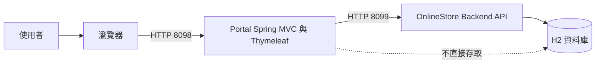

瀏覽器透過 Portal 頁面與資料端點工作；Portal 以固定後端位址轉送查詢與存檔。Portal 不直接連線資料庫，登入狀態只保存在 Portal 的 HttpSession。
後端未啟動時 Portal 頁面仍可登入與開啟，資料操作則回傳錯誤文字。對應 P-COM-13～P-COM-16、P-NFR-03～P-NFR-05、P-NFR-10。

## 2. 循序圖 Sequence Diagram

### SD-01 登入、存取控制與登出

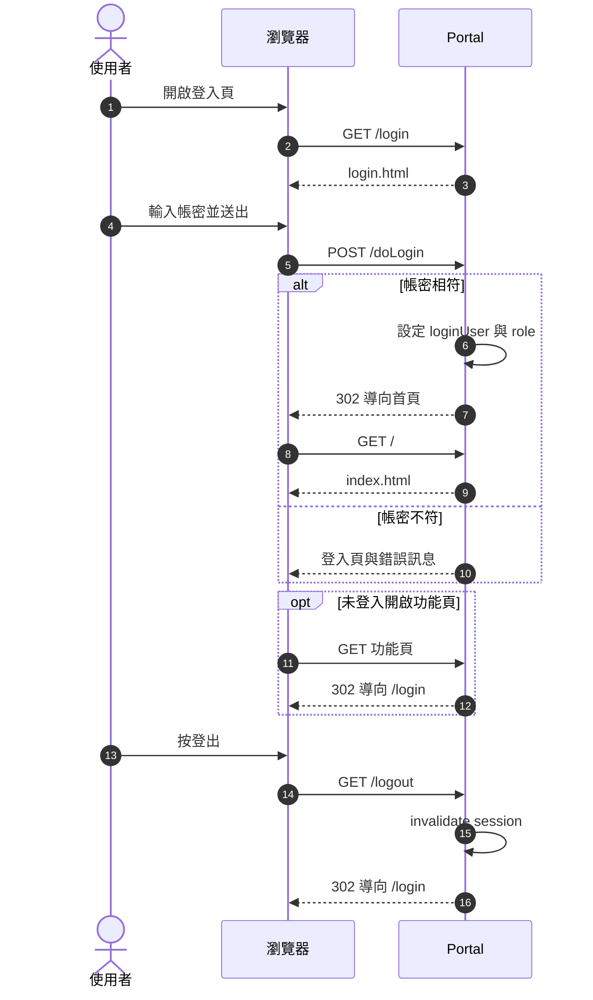

Portal 對三組固定帳密驗證；角色值等於帳號，所有登入者可使用相同功能。已登入時重新登入會覆寫同一 session 的帳號與角色，不更換 session id。未登入頁面請求導向登入頁；未登入資料端點則依端點回 `please login` 或 `[]`，不導向頁面。對應 P-LGN-01～P-LGN-09、P-COM-01～P-COM-06、P-COM-02。

### SD-02 首頁與共用導覽

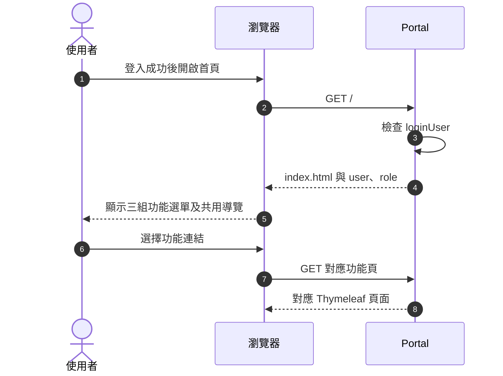

首頁的 SA、Merchant、CSR 區塊與導覽列均由 Portal template 提供；不依登入角色過濾連結。各功能頁共用導覽項目，登入頁除外。對應 P-HOME-01～P-HOME-05、P-COM-07～P-COM-12。

### SD-03 交易報表查詢

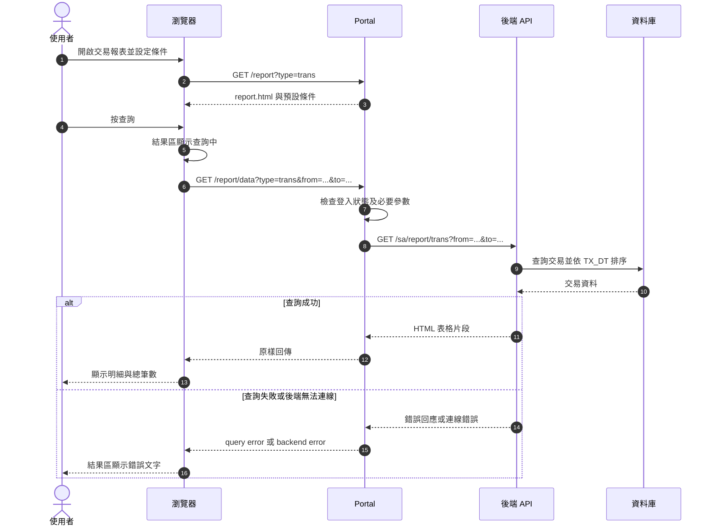

頁面以瀏覽器本機日期初始化條件；Portal 只依 `type` 是否為 `refund` 選擇報表 API，交易報表另轉送商家及時間類型。後端以 TX_DT 或 AUTH_DT 篩選、依 TX_DT 升冪，最多輸出 10 列。對應 P-RPT-01～P-RPT-13、P-COM-15、P-COM-17～P-COM-29、P-COM-33～P-COM-35、P-API-01、P-API-02。

### SD-04 退款報表查詢

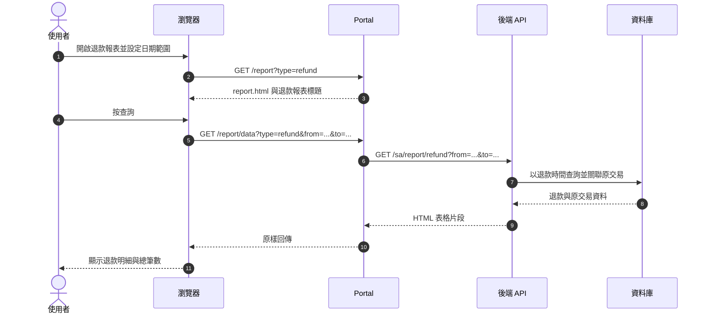

退款頁與交易報表共用 template，但隱藏商家與時間類型欄位。後端依 REFUND_DATE 篩選並排序，只輸出可對應原交易的退款。對應 P-RFD-01～P-RFD-07、P-COM-20～P-COM-29、P-API-01、P-API-02。

### SD-05 每日／每月對帳與差異明細

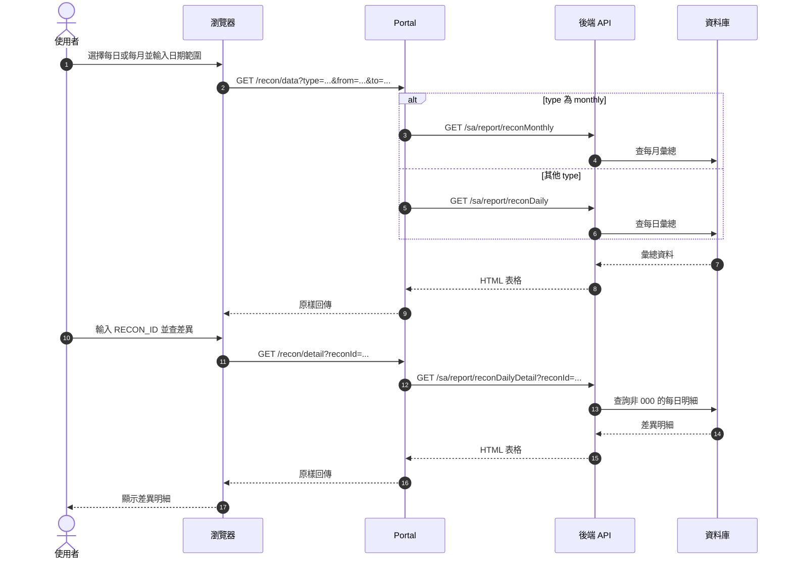

彙總查詢與差異明細由兩個獨立結果區呈現。每月識別碼送至每日差異明細查詢時不會得到資料；空白識別碼仍會送出查詢。對應 P-RCN-01～P-RCN-12、P-COM-20～P-COM-29、P-API-01、P-API-02。

### SD-06 服務條款查詢、新版次與讀取

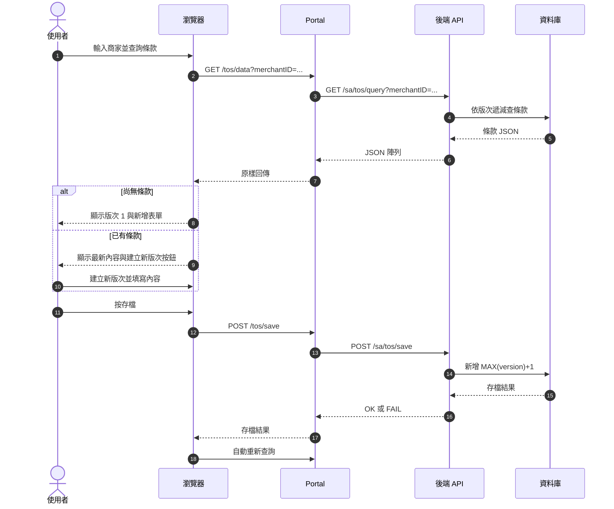

Portal 顯示最新版本並以新增方式建立後續版本；既有版本不提供修改。存檔後自動重查，存檔訊息會在重查完成時清除。對外讀取條款的 `/getToS.jsp` 由後端直接提供，不經 Portal。對應 P-TOS-01～P-TOS-18、P-COM-16、P-COM-30～P-COM-32、P-API-01、P-API-02、P-API-04。

### SD-07 商家銀行帳戶註冊與清單

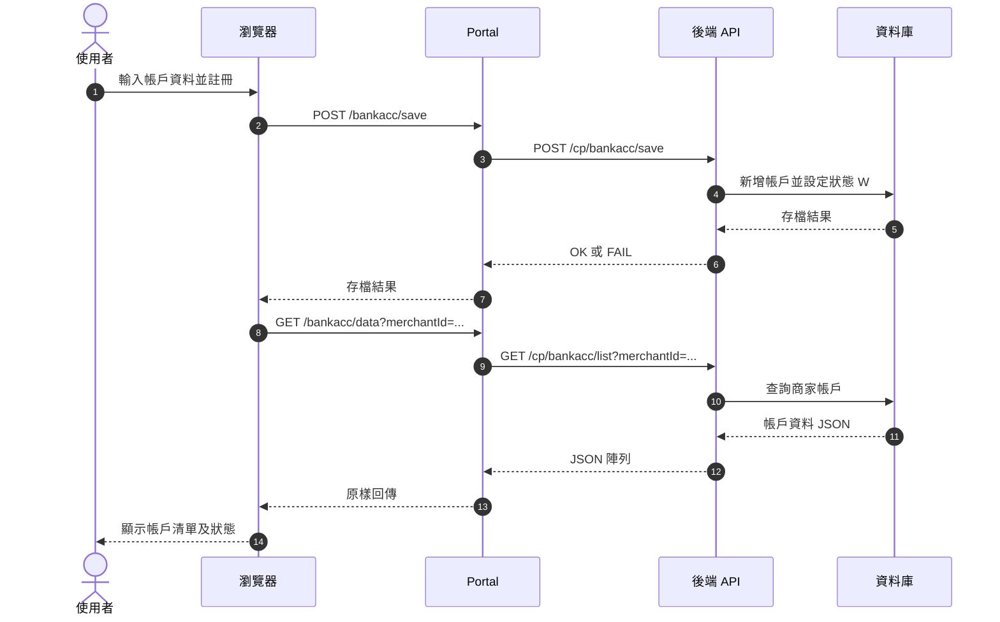

註冊回應顯示於訊息區，隨後自動重查清單；清單依商家代碼完全相符查詢，不限制列數或排序。帳戶表沒有主鍵，重複資料可存在。對應 P-BNK-01～P-BNK-14、P-COM-16、P-COM-30～P-COM-32、P-API-01、P-API-02、P-API-04。

### SD-08 CSR 交易與退款查詢

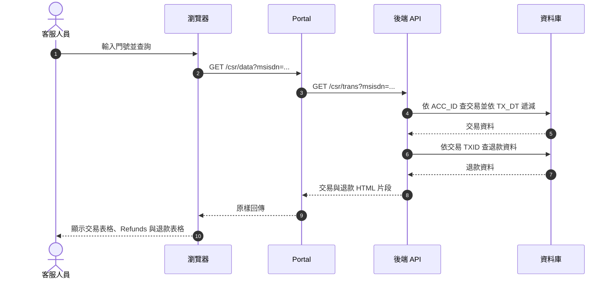

CSR 查詢一次回傳交易及退款兩個表格，各自計算總筆數並最多列出 10 筆。兩段查詢可個別回傳查詢錯誤。對應 P-CSR-01～P-CSR-10、P-COM-15、P-COM-20～P-COM-29、P-API-01、P-API-02。

## 3. 活動圖 Activity Diagram

### AD-01 存取控制

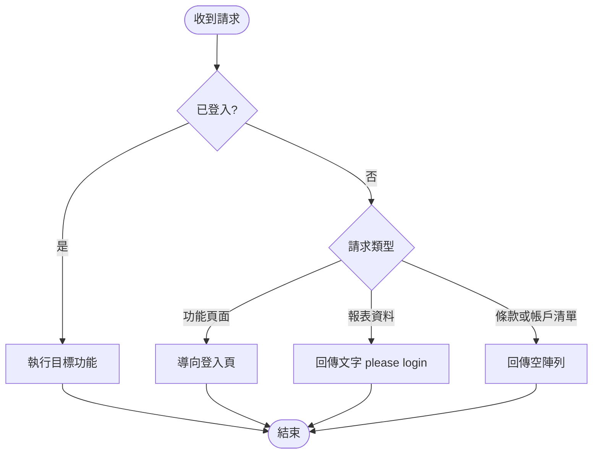

頁面請求與資料請求的未登入處理不同；登入後不再依角色授權。對應 P-COM-01～P-COM-06。

### AD-02 報表查詢與結果呈現

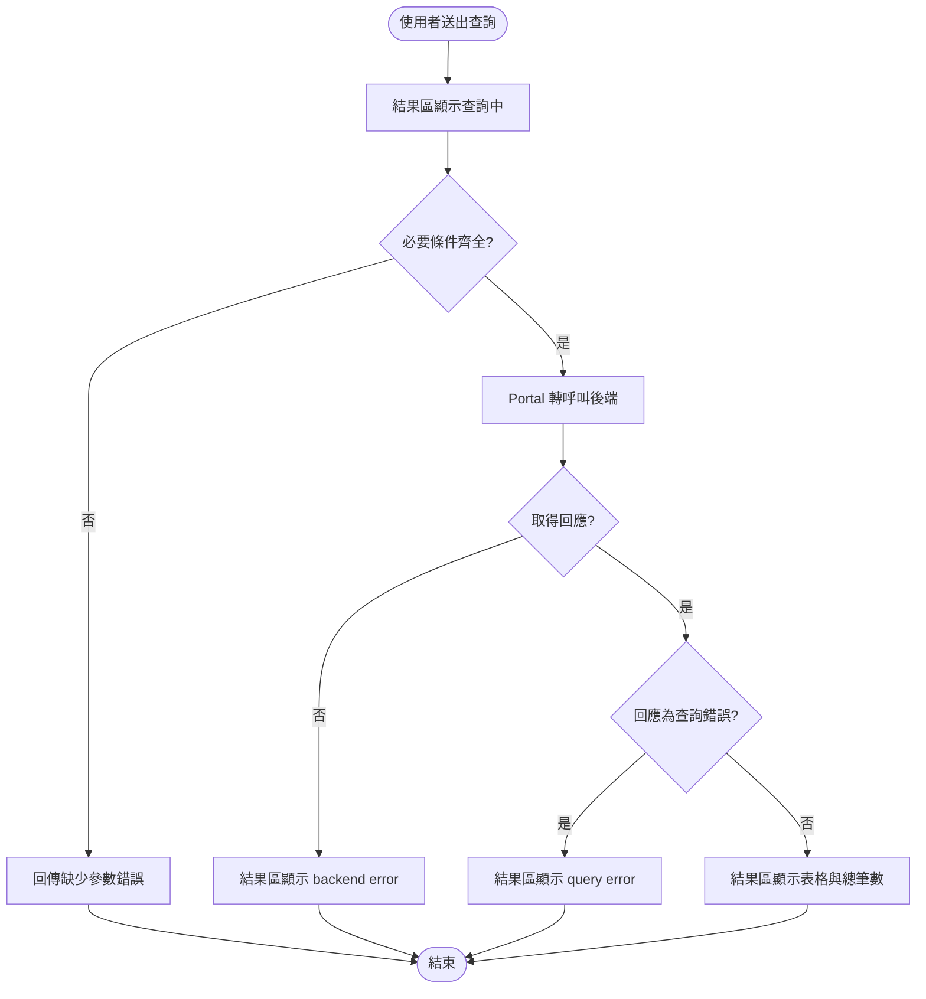

結果區在請求期間顯示等待文字，收到回應後整區取代。查詢可重複送出；回應以最後到達者為準。對應 P-COM-15、P-COM-17、P-COM-19～P-COM-28。

### AD-03 Portal 轉呼叫與錯誤處理

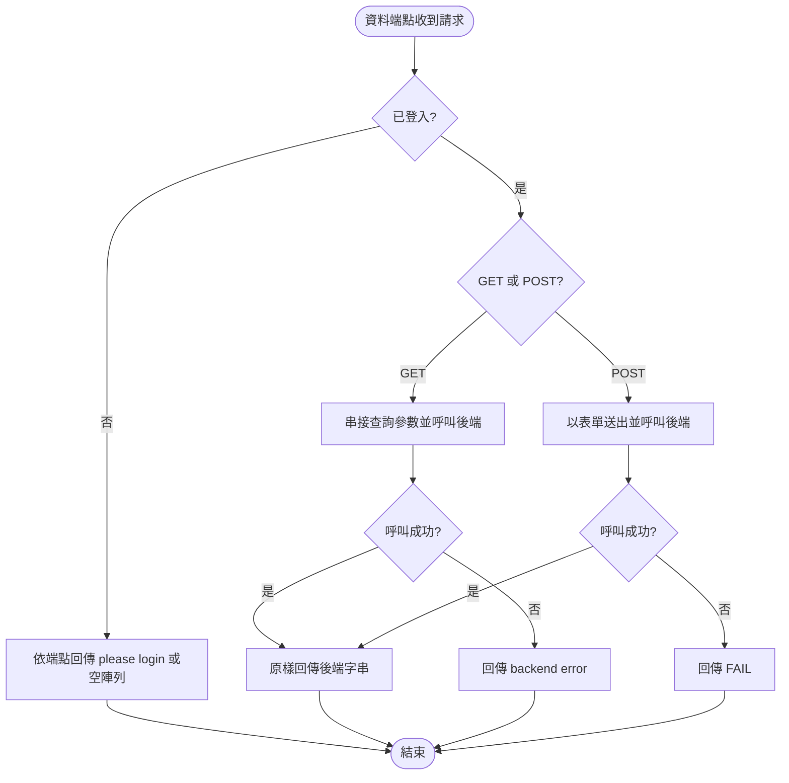

GET 查詢回應由 Portal 原樣轉送；GET 連線失敗回 `backend error:`，POST 連線失敗回 `FAIL`。呼叫未設定逾時。對應 P-COM-13～P-COM-19、P-API-01、P-API-02。

### AD-04 服務條款狀態流程

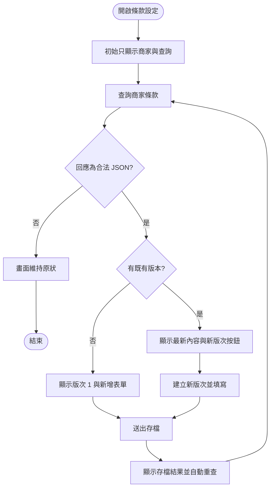

既有版本只讀；存檔後重查，重查結果決定檢視或新增狀態，並清除短暫訊息。對應 P-TOS-01～P-TOS-16。

### AD-05 銀行帳戶新增與查詢

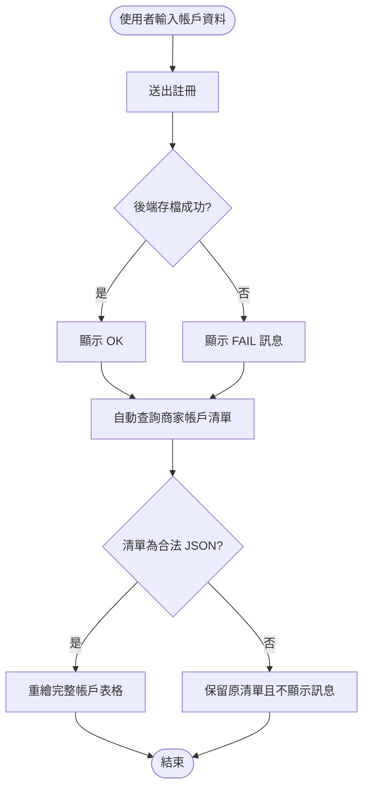

註冊成功或失敗都會觸發清單查詢；註冊訊息不會被清單刷新清除。對應 P-BNK-01～P-BNK-14。

## 4. 資料模型 ER Model

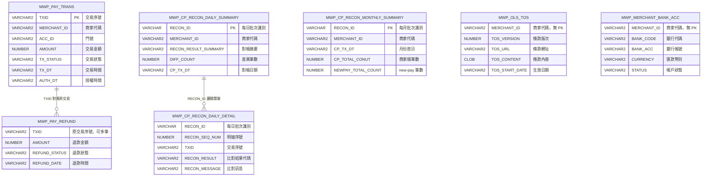

實體與欄位依 SRS 第 6.1 節；圖中 TXID 與 RECON_ID 關係用於說明查詢語意，並非所有資料表都有資料庫 FK 約束。MWP_OLS_TOS 與 MWP_MERCHANT_BANK_ACC 無主鍵；退款檔允許同一 TXID 多筆。

| 資料表 | 使用頁面 |
|---|---|
| MWP_PAY_TRANS | 交易報表、退款報表關聯、CSR 查詢 |
| MWP_PAY_REFUND | 退款報表、CSR 查詢 |
| MWP_CP_RECON_DAILY_SUMMARY | 對帳每日彙總 |
| MWP_CP_RECON_MONTHLY_SUMMARY | 對帳每月彙總 |
| MWP_CP_RECON_DAILY_DETAIL | 對帳差異明細 |
| MWP_OLS_TOS | 服務條款設定、用戶端條款讀取 |
| MWP_MERCHANT_BANK_ACC | 商家銀行帳戶註冊與清單 |

## 附錄 A 設計元素 ↔ SRS 條文 ↔ User Story 對照表

| 設計元素 | SRS 條文 | User Story |
|---|---|---|
| SD-01、AD-01 | P-COM-01～P-COM-06、P-LGN-01～P-LGN-09 | US-COM-01、US-LGN-01、US-LGN-02 |
| SD-02 | P-COM-07～P-COM-12、P-HOME-01～P-HOME-05 | US-COM-02、US-HOME-01 |
| SD-03 | P-RPT-01～P-RPT-13、P-COM-15～P-COM-29 | US-RPT-01～US-RPT-03 |
| SD-04 | P-RFD-01～P-RFD-07、P-COM-20～P-COM-29 | US-RFD-01、US-RFD-02 |
| SD-05 | P-RCN-01～P-RCN-12、P-COM-20～P-COM-29 | US-RCN-01～US-RCN-03 |
| SD-06、AD-04 | P-TOS-01～P-TOS-18、P-COM-30～P-COM-32 | US-TOS-01～US-TOS-03 |
| SD-07、AD-05 | P-BNK-01～P-BNK-14、P-COM-30～P-COM-32 | US-BNK-01、US-BNK-02 |
| SD-08 | P-CSR-01～P-CSR-10、P-COM-20～P-COM-29 | US-CSR-01、US-CSR-02 |
| ER Model | SRS 6.1～6.3 | US-RPT-02、US-RFD-02、US-RCN-01～US-RCN-03、US-TOS-01～US-TOS-03、US-BNK-01～US-BNK-02、US-CSR-01～US-CSR-02 |

## 附錄 B SRS 條文與系統設計對照

SRS 的 API 技術條文使用既有編號 P-API-01、P-API-02、P-API-04；原文件 API 條文編號有缺號。非功能需求 P-NFR-01～P-NFR-11 由部署、執行與測試環境承接，不另建立使用者流程圖。服務條款與銀行帳戶初始資料依 SRS 6.3，作為驗收環境資料，不另外建立系統實體。

| 條文 | 設計 |
|---|---|
| P-API-01、P-API-02、P-API-04 | SD-03～SD-08 |
| P-NFR-01～P-NFR-11 | SD-01、SD-02；測試條件見 user-stories.md |
| P-TOS-18、P-BNK-12 | SD-06、SD-07 |